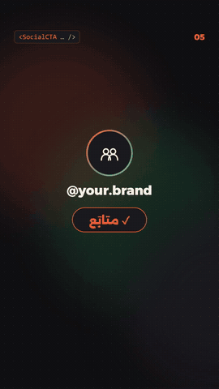
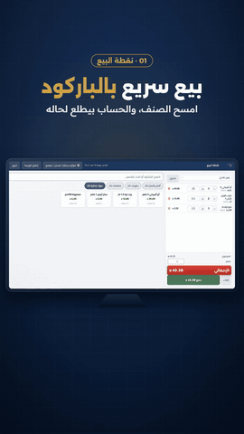

# motion-lab — Arabic Motion Kit + Jard promo

> عُدّة موشن عربية (6 قوالب Remotion) + فيديو ترويجي لبرنامج «جَرْد».

<p align="center"> &nbsp; </p>

Two vertical (1080×1920) films in one Remotion project, sharing a motion kit, transitions and a music generator.

**Watch:** [portfolio](https://suliman-hasanien.github.io/portfolio/#work)

## Arabic Motion Kit — `src/kit/templates.tsx`
Six reusable templates. Each is one React component, styled by a `KitTheme` object (`coral`, `sand`, `ocean`, or your brand):

| Template | What it does |
|---|---|
| `TitleCard` | kicker + masked headline reveal + accent bar |
| `LowerThird` | name / role bars that wipe in right-to-left |
| `StatCounter` | number counts up inside a progress ring |
| `QuoteCard` | quote mark pop + word-by-word Arabic quote |
| `SocialCTA` | handle + "follow" button pressed by an animated cursor |
| `OfferBadge` | rotating starburst %, struck old price, new price pop |

```tsx
import {LowerThird, THEMES} from "./kit/templates";
const brand = {...THEMES.ocean, accent: "#E4002B"};
<LowerThird t={brand} name="سليمان حسنين" role="مطوّر وموشن ديزاينر" at={20} />
```

## Jard promo — `src/jard/JardPromo.tsx`
A 41-second promo for my accounting app **Jard**, built from real app screenshots: hook → logo → POS → invoices → multi-currency debts → stock & barcodes → feature grid → outro. Screenshots sit in a 3D monitor frame with push-ins and gold spotlight boxes.

## Shared
- `src/shared/kit.tsx` — `Words` (per-word Arabic motion), `Swoosh`, easing helpers.
- `src/shared/transitions.tsx` — `SceneTrack`: lays scenes out from a `timeline.json` with slide (motion-blur) and flash transitions.
- `work/make_music.py` — original score synthesized from the same `timeline.json` (100 BPM, 1 beat = 18 frames), so cuts land on the beat.

## Run
```bash
npm install
python work/make_music.py src/kit/timeline.json public/kit_music.wav
python work/make_music.py src/jard/timeline.json public/jard_music.wav
npx remotion studio src/index.ts
npx remotion render src/index.ts MotionKitReel out/kit.mp4
npx remotion render src/index.ts JardPromo out/jard.mp4
```

---
Built by **Suliman Hasanien** with an AI-assisted workflow (Claude Code). Jard and its screenshots are my own product (SMT Technologies). Fonts: Alexandria & Readex Pro (SIL OFL).
